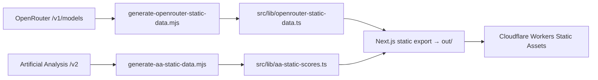

# TokenTickr

> **Find the value sweet spot for LLM agents — price, intelligence, and context, compared honestly.**

TokenTickr compares LLM models side-by-side for the agentic era: what a model costs *per completed task* (not per chat message), whether it can actually act (tool calling, structured outputs, reasoning), and how much working set fits in one context window without compaction.

**Live demo:** [tokentickr.com](https://tokentickr.com)

## What you get

- **Compare up to 4 models** side-by-side with aligned cards, ranking badges (cheapest / largest context), and cost charts that scroll cleanly on mobile.
- **1-click presets** — *Frontier Coding Agents*, *Reasoning vs Speed*, *Low-Cost Tool Routers* — fill the comparison from capability flags, no hunting through 470 models.
- **Agentic Readiness on every card** — Tools, Thinking, JSON Schema, and prompt-caching support, plus cache-read pricing and the output premium ratio ("reasoning tax").
- **Workload-aware costs** — pick a workload profile (Chat Default 1.5k, Tool Agent 18k, Coding Agent 95k, Deep Research 136k tokens/task) and a monthly task volume; every dollar figure recomputes. No more fictional "1,000 in + 500 out queries".
- **Agent Runway panel** — for a given budget: tasks completed per $, cost per 1k tasks, reasoning tax, and a context-fit warning when a task's working set exceeds 80% of a model's window.
- **Role tiers, not price terciles** — models grouped as Reasoning & Planning, Coding & Tool Execution, Long-Context Synthesis, High-Speed Routing.
- **Context in agent units** — bars read `128k · ~31 agent turns · $0.38 full-window` (turns before compaction + cost to fill the window once). No book analogies.
- **Smart Value Ranking** — intelligence-weighted composite with full provenance labels (MMLU-Pro, AA Index, verified, or *Insufficient Data* — never silently estimated).

## Smart Value Index

TokenTickr's core question: *"If I use this cheaper model instead of the frontier model, how much intelligence do I give up for how much savings?"*

Scoring uses dynamic tier-based weighting relative to the best model in the comparison set:

| Tier | Definition | Intel | Context | Price | Philosophy |
|------|------------|-------|---------|-------|------------|
| **Frontier** | 90%+ of max perf | 60% | 35% | 5% | "Those that pay, will pay" |
| **Pro** | 70–90% of max | 50% | 30% | 20% | The "deals" zone — tradeoff land |
| **Budget** | <70% of max | 35% | 25% | 40% | Volume-first, price matters |

- **Context gate:** models under ~64K context are penalized — intelligence without capacity is limited.
- **Two modes:** *Smart Score* (intelligence-first) and *Budget Score* (efficiency-first).
- **Performance cascade:** curated static overrides → MMLU-Pro (Artificial Analysis) → AA Intelligence Index → verified LMSYS/estimated evals → **Insufficient Data** (excluded from ranking, never guessed).

## How it works

Data is fetched at **build time** and committed as static TypeScript — no runtime API calls, no keys in the request path.



- Codegen **soft-fails offline**: if an API is down or a key is missing, the build reuses the last committed data instead of failing.
- The OpenRouter minifier keeps only agent-critical fields (per-token prices, cache/reasoning pricing, allowlisted `supported_parameters`) to keep the bundle lean.
- Generation is guarded so the scripts are importable by tests without side effects.

### Data freshness

| Source | Models | Last generated | Refresh |
|--------|--------|----------------|---------|
| OpenRouter (price, context, capabilities) | 470 | 2026-10-19 | `npm run generate:openrouter-data` |
| Artificial Analysis (MMLU-Pro, Intelligence Index, coding, instruction-following) | 367 scored | 2026-01-03 ⚠️ | `npm run generate:aa-data` (needs key) |

⚠️ AA scores predate the current model generation — treat intelligence rankings as directional until the next keyed refresh. A monthly GitHub workflow (`.github/workflows/refresh-data.yml`) regenerates both datasets and opens a PR; it never pushes to `main` directly.

Full methodology: [docs/DATA_SOURCES.md](docs/DATA_SOURCES.md) · Research notes: [docs/research/](docs/research/)

## Quickstart

Prerequisites: **Node 22.x**, npm.

```bash
git clone https://github.com/jayanthkumarak/TokenTickr.git
cd TokenTickr
npm install
npm run dev        # http://localhost:3000
```

Optional keys (`.env.local`): `NEXT_PUBLIC_AA_API_KEY` for benchmark refresh; `NEXT_PUBLIC_OPENROUTER_API_KEY` only improves generation rate limits. The app runs fully offline on committed data without either. Note: `NEXT_PUBLIC_AA_API_KEY` is baked into the client bundle by design (public Artificial Analysis key usage).

## Scripts

| Command | What it does |
|---------|--------------|
| `npm run dev` | Dev server (Turbopack) on :3000 |
| `npm run build` | Regenerate static data (soft-fail) + static export to `out/` |
| `npm run deploy` | `wrangler deploy` to Cloudflare Workers Static Assets |
| `npm run preview` | `wrangler dev` against the built site |
| `npm test` | Vitest unit/component suites (`src` + `tests`) |
| `npm run test:e2e` | Playwright browser tests (port 3002 via config webServer) |
| `npm run lint` | ESLint flat config |
| `npm run generate:static-data` | Regenerate both datasets (`-- --force` to bypass AA 7-day cache) |

## Testing

```bash
npm test                  # 70+ unit/component tests
npx playwright test       # Chromium / Firefox / WebKit projects
```

Suites cover the risky logic: AA slug matching (no substring inheritance — a `*-mini` never inherits the base model's score), workload cost math, capability detection, theme compliance, and data-generation transforms against the real generator functions.

## Deployment

Single target: **Cloudflare Workers Static Assets**, served from `out/`.

- **CLI:** `npm run build && npm run deploy`
- **CI:** pushes to `main` run tests, then the `deploy` job in `.github/workflows/tests.yml` publishes (skips with a warning when `CLOUDFLARE_API_TOKEN` / `CLOUDFLARE_ACCOUNT_ID` secrets are absent).
- Security headers (`public/_headers`: HSTS, frame, sniff, referrer, permissions) ship with the export.

Telemetry/pricing-history Pages Functions and the D1 binding were removed in the revival — the site is purely static. `migrations/` is kept for historical reference only.

## Project structure

```
src/
  app/            # Next 16 App Router (static export)
  components/     # Cards, charts (VisX 4), ranking, runway, selectors
  lib/            # price-calculation, capability-bonus, AA/OpenRouter clients,
                  # generated static data, scoring utils
  store/          # Zustand comparison store (max 4 columns)
scripts/          # Data generators (OpenRouter + AA)
tests/            # Playwright specs + generator tests
docs/             # Data sources, research, archived build notes
```

Stack: Next.js 16 · React 19 · TypeScript 5 (ES2020) · Tailwind CSS 4 · shadcn/ui (Radix) · Zustand · VisX 4 · Vitest · Playwright · Wrangler 4.

## For AI agents

Read [LLM_READ_ME_NOW.md](LLM_READ_ME_NOW.md) first — a high-density technical summary of architecture, data pipeline, and matching logic.

## Release history

### main — Revival + Agentic Redesign (2026-10)
- **Deploy single truth:** Pages Functions + D1 removed; Workers Static Assets via CLI and CI deploy job; monthly data-refresh PR workflow.
- **Hermetic builds:** offline-proof codegen, AA envelope + matching fixes (no substring score inheritance), OpenRouter refreshed to 470 models.
- **Agentic redesign:** workload profiles, Agent Runway panel, role tiers, preset bar (replaces the blocking welcome modal), token-only visual system, 4-column cap.
- **Modern stack:** Next 16 / React 19, VisX 4, flat ESLint (no `next lint`), `.npmrc` legacy-peer-deps removed (vitest pinned at 4.0.16 — 4.1 breaks `.tsx` transforms).

### v3.6.2 (Security Hardening)
- Static security headers for exported pages (HSTS, anti-sniff, clickjacking, referrer, permissions).

### v3.5.x (Intelligence & Matching)
- MMLU-Pro as primary intelligence metric; "Insufficient Data" models filtered from rankings.
- Token-based fuzzy matching across OpenRouter ↔ Artificial Analysis naming conventions.

### v3.0.0 (Polish)
- Model-card UI redesign; build-time static data generation (v2.5) eliminating runtime fetch latency.

## Contributing

Issues and PRs welcome. Please run `npm test && npm run lint` before submitting; data-file changes (`src/lib/*static*.ts`) should come from the generators, never hand-edits.

## License

Apache-2.0 — see [LICENSE](LICENSE).

Data attribution: pricing by [OpenRouter](https://openrouter.ai), intelligence benchmarks by [ArtificialAnalysis.ai](https://artificialanalysis.ai), human-preference Elo by [LMSYS Chatbot Arena](https://chat.lmsys.org).
